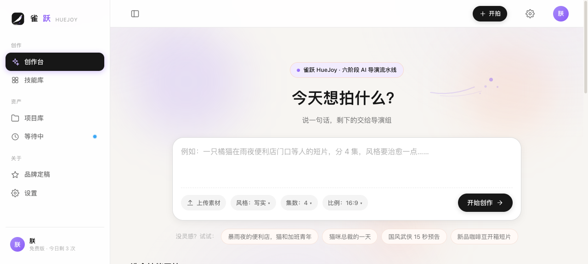
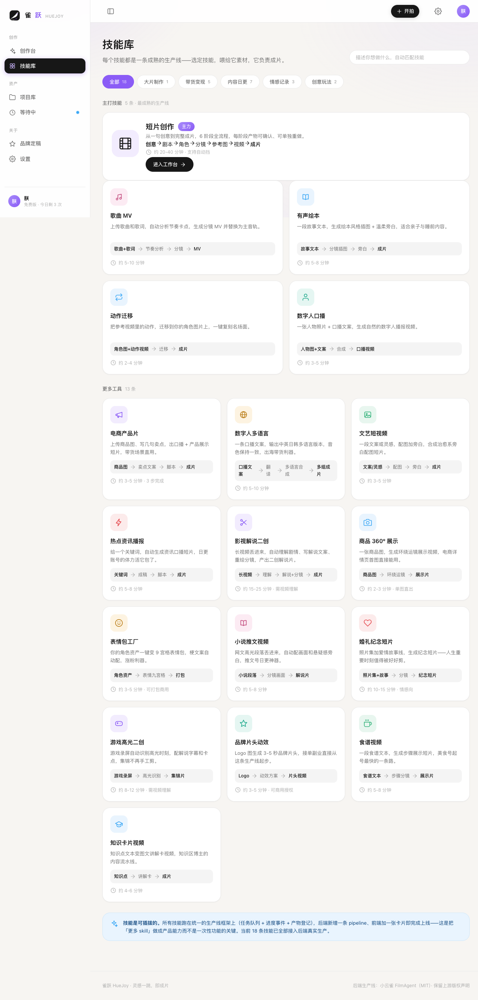
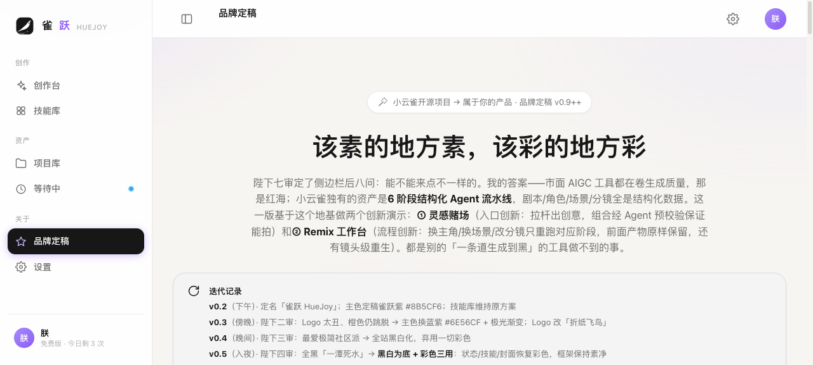
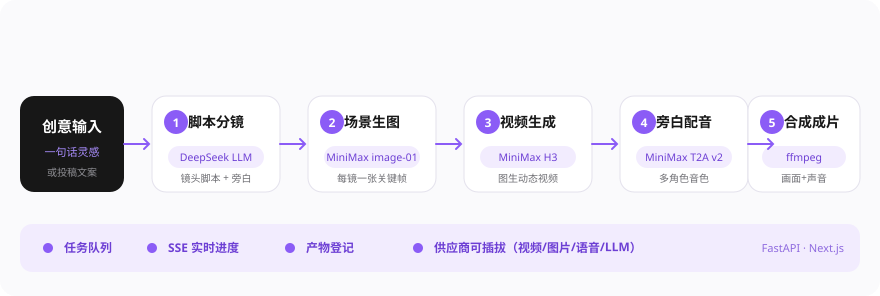

# 雀跃 HueJoy

> 把一句话变成一条成片——六阶段 AI 导演流水线，18 个视频创作技能，一个属于你的 AIGC 平台。

<p align="center">
  <br>
  <sub><b>平台真实产出</b>：12 秒短片《不熄的灯》——从一句话到分镜、生图、视频、配音、合成，全自动完成</sub>
</p>

## 平台界面

| 首页创作台 | 技能库 | 品牌定稿 |
|:---:|:---:|:---:|
|  |  |  |

## 六阶段流水线

输入一个想法，流水线自动跑完六个阶段，产出带旁白、带画面、带节奏的成片：

<p align="center">
  
</p>

## 18 个技能，四类场景

| 场景 | 技能 |
|---|---|
| 大片制作 | 短片创作（六阶段主流程） |
| 带货变现 | 电商产品片、数字人口播、数字人多语言、360° 产品展示、品牌短片 |
| 内容日更 | 艺术短视频、新闻播报、影视解说、小说推文、游戏集锦、美食视频、知识卡片 |
| 情感记录 | 歌曲 MV、有声绘本、婚礼影片 |
| 创意玩法 | 动作迁移、表情包工厂 |

技能是可插拔的：所有技能跑在统一的生产线框架上（任务队列 + 进度事件 + 产物登记），后端新增一条 pipeline、前端加一张卡片即完成上线。

## 技术栈

- **后端**：FastAPI + Python 3.10+，任务队列 + SSE 实时进度事件 + 产物登记
- **前端**：Next.js（App Router）+ Tailwind CSS，雀跃紫 `#8B5CF6` 品牌体系
- **供应商**：MiniMax（视频 H3 / 图片 image-01 / 语音 T2A）+ DeepSeek（分镜与文案），架构上可插拔扩展 Ark、DashScope、可灵
- **降级策略**：TTS 四级降级（minimax → edge → say），视频按模型名路由供应商

## 快速开始

### 后端（:8000）

```bash
cd backend
python3 -m venv .venv && source .venv/bin/activate
pip install -r requirements.txt
cp .env.example .env               # 填入各家 API Key（密钥放这里）
cp config.yaml.example config.yaml # 非敏感配置（模型选择等）
python api_server.py
```

### 前端（:3100）

```bash
cd frontend
npm install
npm run build
npm start
```

打开 http://localhost:3100 ，在首页输入想法即可开拍，进度实时可见，完成自动登记产物。

## 配置

密钥统一放在 `backend/.env`（模板见 `.env.example`），环境变量优先于 `config.yaml`——`.env` 是密钥唯一真源，`config.yaml` 只留模型选择等非敏感配置。两个文件均已被 `.gitignore` 排除，不会上传。

```bash
cd backend
cp .env.example .env   # 填入各家 API Key
```

命名规则：`<供应商>_API_KEY` / `<供应商>_BASE_URL` / `<供应商>_ENABLE_PROXY`（可灵用 `KLING_ACCESS_KEY` / `KLING_SECRET_KEY`），支持 OpenAI、Gemini、DeepSeek、DashScope、Ark、可灵、TokenPlus、MiniMax 八家。在设置页修改密钥会写穿回 `.env`，Docker / CI 里也可直接用环境变量注入。

| 配置 | 用途 |
|---|---|
| `llm` | 分镜脚本 / 旁白文案生成（DeepSeek 等 OpenAI 兼容接口） |
| `minimax` | 视频生成（H3）、图片（image-01）、语音合成（T2A v2） |
| `image` / `video` | 模型选择与路由 |

## 目录结构

```
├── backend/
│   ├── api/            # FastAPI 路由与 SSE 进度推送
│   ├── pipelines/      # 六阶段流水线与 18 个技能管线
│   ├── models/         # 供应商客户端（视频/图片/语音/LLM）
│   ├── prompts/        # 各阶段提示词模板
│   └── config.yaml.example
├── frontend/
│   ├── app/            # Next.js 页面（首页 / 技能库 / 工作台 / 品牌定稿）
│   ├── components/     # 布局与业务组件
│   └── data/           # 技能定义与表单 schema
├── docs/               # README 截图与架构图
└── install.sh / install.bat   # 原始部署脚本
```

## 致谢

本项目基于开源项目 [xiaoyunque](https://github.com/HITsz-TMG)（FilmAgent 流水线底子）改造扩展，感谢原作者的开放工作。

## License

MIT
